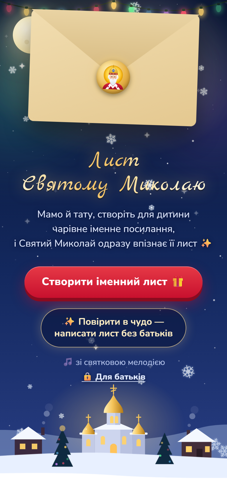
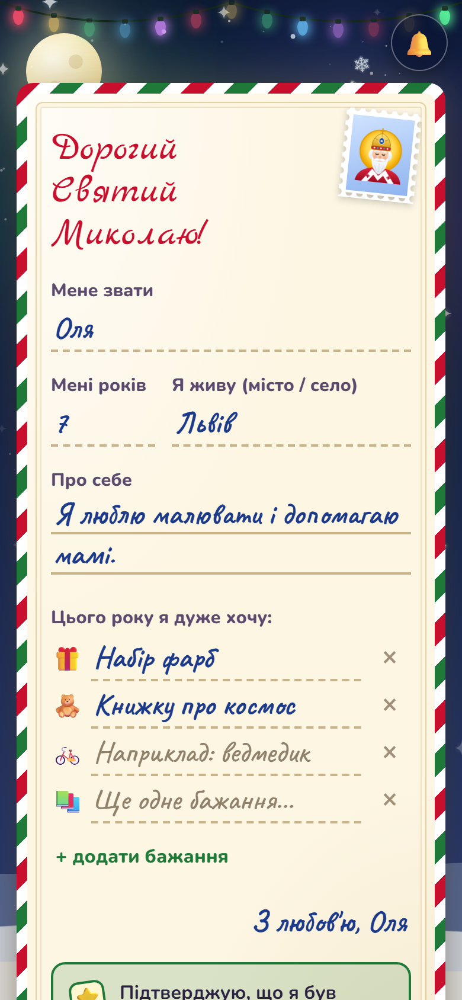
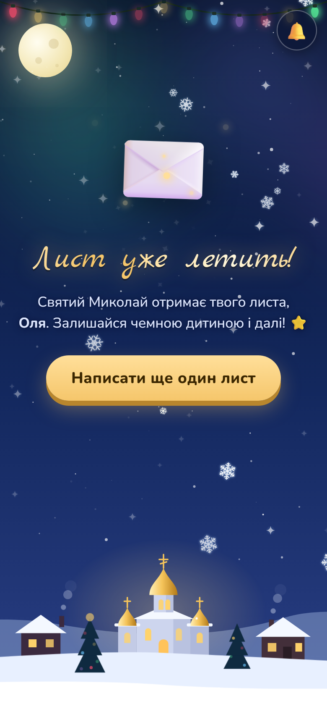
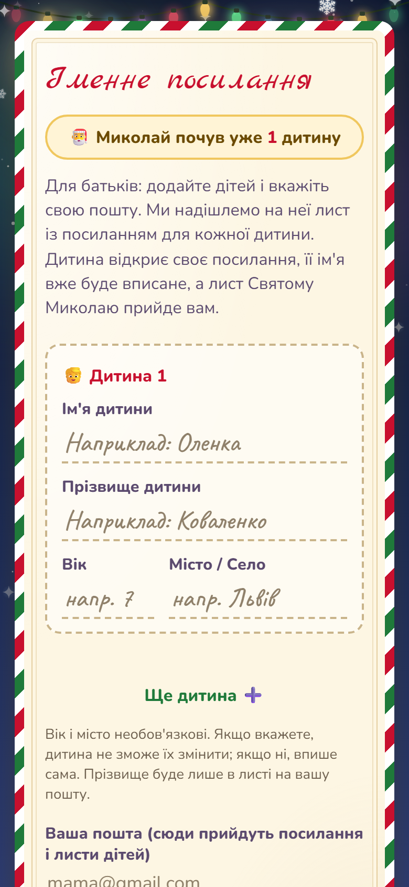
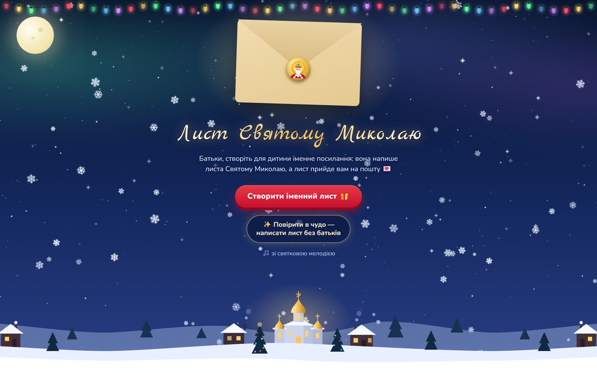
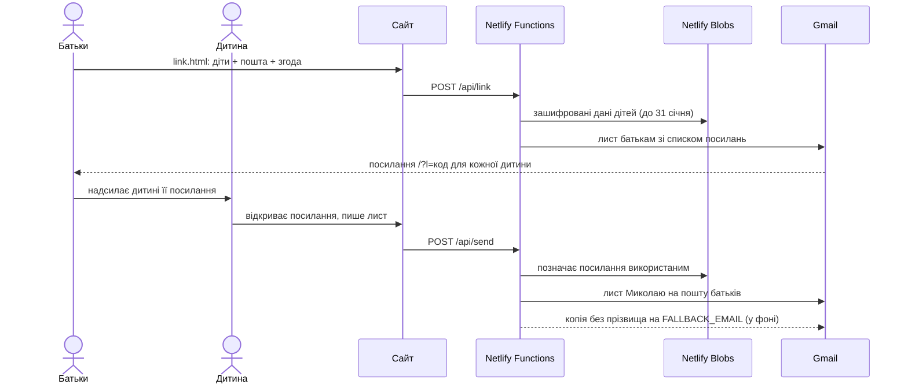

<div align="center">


# Лист Святому Миколаю

Казковий сайт, на якому дитина пише лист Святому Миколаю, а лист приходить на пошту батькам.

[](https://santa-nicolas-letter.netlify.app)


[](LICENSE)

**[santa-nicolas-letter.netlify.app](https://santa-nicolas-letter.netlify.app)**






</div>

## Зміст

- [Можливості](#можливості)
- [Як це працює](#як-це-працює)
- [Швидкий старт](#швидкий-старт)
- [Змінні середовища](#змінні-середовища)
- [Локальний запуск](#локальний-запуск)
- [Структура проєкту](#структура-проєкту)
- [API](#api)
- [Безпека і приватність](#безпека-і-приватність)
- [Статистика](#статистика)
- [Примітки](#примітки)
- [Ліцензія](#ліцензія)

## Можливості

- 🌙 **Анімоване зимове небо**: сніг, зорі, північне сяйво, гірлянда, нічне містечко з церквою. Працює на canvas і зберігає заряд на iPhone (з `prefers-reduced-motion` анімація сповільнюється).
- 🎶 **«Щедрик»** (М. Леонтович, суспільне надбання) синтезується прямо в браузері через Web Audio, без аудіофайлів. Можна задати свій mp3.
- ✉️ **Лист**: ім'я, вік, місто чи село, кілька слів про себе, список бажань і галочка «Підтверджую, що я був чемним / була чемною весь рік». Без галочки лист не надсилається.
- 👨‍👩‍👧 **Іменні посилання для батьків**: головна сторінка веде батьків до створення посилань. Батьки додають одну або кілька дітей (картки гортаються вбік), отримують на пошту окреме коротке посилання для кожної дитини (`/?l=Ab3dE9xZ`). Ім'я в листі вже вписане, а лист приходить батькам.
- ✨ **«Повірити в чудо»**: дитина, яка прийшла сама, теж може написати лист без батьків, просто з головної сторінки.
- 🔒 **Одне посилання — один лист**: після надсилання посилання більше не діє, а дитина бачить «Лист уже в Миколая!».
- 📬 **Резервна копія** кожного листа (без прізвища) на окрему пошту з мітками в темі.
- 📱 **Mobile-first**: зроблено під iPhone (safe area, альбомна орієнтація, «На екран Додому»), добре виглядає і на десктопі.
- ♿ **Доступність**: підписи для зчитувачів екрана, помилки біля потрібного поля, достатній контраст.
- 🧩 **Без фреймворків і збірки**: чистий HTML, CSS і JavaScript, а сервер — це три функції Netlify.

<p align="center"></p>

## Як це працює



Лист з посиланнями водночас підтверджує пошту батьків: посилання не показуються на сайті, тож отримати їх може лише власник скриньки.

Головна сторінка без посилання (`/`) звертається до батьків: кнопка «Створити іменний лист» веде на `link.html`. Друга кнопка, «✨ Повірити в чудо — написати лист без батьків», відкриває звичайний лист; такий лист іде на резервну пошту `FALLBACK_EMAIL`. За іменним посиланням (`/?l=…`) дитина бачить лише своє привітання і кнопку «Відкрити лист».

## Швидкий старт

### 1. Пароль застосунку Gmail

1. Увімкніть **Двоетапну перевірку**: https://myaccount.google.com/security
2. Створіть пароль застосунку (наприклад, з назвою «Миколай»): https://myaccount.google.com/apppasswords
3. Скопіюйте 16 символів.

> Gmail дозволяє надсилати близько 500 листів на добу.

### 2. Сайт на Netlify

Netlify Drop не підтримує функції, тому публікуйте через CLI:

```bash
git clone <url цього репозиторію>
cd SantaNicolasLetter
npm install
npx netlify-cli login
npx netlify-cli init          # або: npx netlify-cli link --id <site id>
```

### 3. Змінні середовища

Задайте змінні з [таблиці нижче](#змінні-середовища) в **Site configuration → Environment variables**.

Ключ для `LINK_SECRET` можна згенерувати так:

```bash
node -e "console.log(require('crypto').randomBytes(32).toString('base64url'))"
```

### 4. Публікація

```bash
npx netlify-cli deploy --prod
```

Після зміни змінних середовища опублікуйте сайт ще раз.

## Змінні середовища

| Змінна | Обов'язкова | Опис |
|---|:---:|---|
| `GMAIL_USER` | ✅ | Адреса Gmail, з якої йдуть листи |
| `GMAIL_APP_PASSWORD` | ✅ | Пароль застосунку з кроку 1 |
| `LINK_SECRET` | ✅ | Ключ шифрування посилань і даних. **Якщо його змінити, усі посилання перестануть працювати** |
| `FALLBACK_EMAIL` | | Резервна пошта для листів без посилання і копій усіх листів. Якщо не задано, використовується `GMAIL_USER` |
| `STATS_KEY` | | Пароль для сторінки статистики `stats.html` |
| `MAIL_FROM_NAME` | | Ім'я відправника, за замовчуванням «Святий Миколай» |
| `MAIL_DAILY_MAX` | | Скільки всього листів сайт може надіслати за добу, за замовчуванням `450` (запас до ліміту Gmail) |
| `FREE_DAILY_MAX` | | Скільки з них можуть бути листами без посилання, за замовчуванням `100` |
| `MAIL_DRY_RUN` | | `1` = не надсилати листи, а повертати їх як JSON (лише для локальних тестів) |

### Мітки в темі листів на `FALLBACK_EMAIL`

| Мітка | Що означає |
|---|---|
| `[Без батьків]` | Дитина написала лист без іменного посилання |
| `[Основний]` | Лист з посилання, де пошта батьків і є резервною |
| `[Копія]` | Копія листа, який пішов батькам (без прізвища дитини) |

## Локальний запуск

Створіть файл `.env` (його не треба додавати в git):

```ini
LINK_SECRET=local-test
MAIL_DRY_RUN=1
STATS_KEY=local
```

і запустіть:

```bash
npm install
npx netlify-cli dev
```

З `MAIL_DRY_RUN=1` листи не надсилаються, а сховище, якщо Netlify Blobs недоступне, працює в пам'яті.

## Структура проєкту

```
public/                  статичний сайт (публікується як є)
├── index.html           лист дитини
├── link.html            сторінка для батьків: створення і «Поділитися» посиланнями
├── privacy.html         які дані куди йдуть
├── stats.html           статистика (за паролем STATS_KEY)
├── app.js               логіка листа
├── sky.js               анімоване небо (canvas)
├── music.js             «Щедрик» на Web Audio
├── config.js            налаштування (наприклад, musicUrl)
└── style.css
netlify/
├── functions/
│   ├── link.mjs         /api/link, /api/confirm, /api/open
│   ├── send.mjs         /api/send
│   ├── stats.mjs        /api/stats
│   └── cleanup.mjs      щоденне прибирання (@daily)
└── lib/
    ├── common.mjs       шифрування, перевірка даних, захист від чужих запитів
    ├── mail.mjs         відправка через Gmail SMTP (nodemailer)
    └── store.mjs        Netlify Blobs: посилання, ліміти, лічильники
docs/screenshots/        скріншоти для README
netlify.toml             публікація, Node 22, заголовки безпеки
```

## API

Усі `POST`-запити приймають лише `Content-Type: application/json` з того самого сайту.

| Метод і шлях | Що робить |
|---|---|
| `POST /api/link` | Приймає пошту батьків, згоду і до 5 дітей (ім'я, прізвище, вік, місто чи село). Зберігає їх зашифрованими і надсилає батькам лист з посиланнями |
| `POST /api/confirm` | За кодом із листа батьків повертає посилання дітей для сторінки «Поділитися» |
| `GET /api/open?l=<код>` | Повертає сторінці дитини лише ім'я, вік і місто. Прізвище і пошта на сайт не потрапляють |
| `POST /api/send` | Надсилає лист Миколаю |
| `GET /api/stats` | Загальна кількість надісланих листів (кешується на 1 хвилину) |
| `POST /api/stats` | Детальна статистика, потрібен заголовок `X-Stats-Key` |

## Безпека і приватність

**Дані**
- Дані дітей і пошта батьків зберігаються в Netlify Blobs, зашифровані AES-256-GCM, і видаляються після 31 січня.
- Для лімітів зберігається лише HMAC-хеш пошти, а статистика містить тільки числа.
- Посилання містить лише випадковий 8-символьний код, без особистих даних.
- Прізвище дитини потрапляє тільки в лист батькам, на сайті його не видно.
- Вік і місто, які вказали батьки, на сторінці дитини заблоковані 🔒, і сервер бере саме їх.

**Захист від спаму**
- Приховане поле-пастка й обмеження довжини полів.
- Не більше 12 листів за 10 хвилин з однієї IP-адреси.
- Не більше 3 листів з посиланнями і 10 листів дітей на одну пошту за добу (за київським часом).
- Загальний добовий бюджет листів (`MAIL_DAILY_MAX`, `FREE_DAILY_MAX`). Коли його вичерпано, сайт просить спробувати завтра.
- Запити з інших сайтів відхиляються (`Sec-Fetch-Site` і `Content-Type: application/json`).
- Листи формуються за фіксованим шаблоном: усі введені дані екрануються, невидимі символи прибираються.

**Заголовки**: `X-Frame-Options`, `Content-Security-Policy: frame-ancestors 'none'`, `Referrer-Policy`, `X-Content-Type-Options`. Сторінки `link.html` і `stats.html` закриті від пошуковиків (`noindex`).

## Статистика

- На `link.html` показано «🎅 Миколай почув уже N дітей», тобто скільки листів уже надіслано.
- `stats.html` (на неї немає посилань) після введення `STATS_KEY` показує листи, створені посилання, відкриті й використані посилання і таблицю за 14 днів.
- Лічильники ведуться з 19.11.2026.

## Примітки

- Музика вмикається після натискання «Відкрити лист», бо так вимагає iOS. Коли вкладку згорнуто, музика стає на паузу. Кнопка 🔔 вимикає звук.
- Свою мелодію можна задати посиланням на mp3 у `musicUrl` у `public/config.js`.
- Чернетка листа зберігається в браузері й не зникає після перезавантаження сторінки.
- Сторінки відкриваються в одній вкладці з анімацією переходу (View Transitions: Safari 18.2+, Chrome 126+).
- «Відкрити лист» на сторінці батьків замінює запис в історії, щоб дитина кнопкою «Назад» не потрапила до форми батьків.
- Щоб сайт відкривався як застосунок, у Safari натисніть «Поділитися» → «На екран Додому».

## Ліцензія

[MIT](LICENSE): код можна вільно використовувати, змінювати й поширювати, зберігаючи текст ліцензії.

Мелодія «Щедрик» (М. Леонтович) — суспільне надбання. Шрифти — з Google Fonts під їхніми відкритими ліцензіями.
